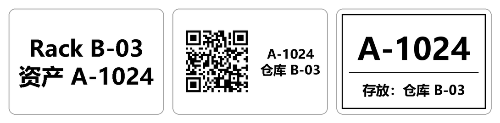

# niimbot-k3w-tcp

Print to a **NIIMBOT K3_W** label printer over the network (Wi‑Fi, TCP port 9100) from Windows, macOS or
Linux — no official app, no Bluetooth. Text (including Chinese), QR codes and images.

[中文说明](README.zh-CN.md)



> Unofficial project, not affiliated with or endorsed by NIIMBOT (精臣). Tested on one printer model;
> see [Status](#status).

## Why

The existing open-source NIIMBOT tools ([niimbluelib](https://github.com/MultiMote/niimbluelib),
[niimprint](https://github.com/kjy00302/niimprint), …) talk to printers over Bluetooth or USB. The K3_W can
also join a Wi‑Fi network, and on TCP port 9100 it accepts the same packet protocol. That makes it usable from
any computer that can reach it — including from another subnet, where the official desktop app did not find
it.

One thing differs from the documented Bluetooth flows: the printer silently refuses a new job while the
previous label is still feeding out, so jobs have to wait for its busy flag. Details are in
[docs/protocol.md](docs/protocol.md).

## Status

| | |
|---|---|
| Tested on hardware | NIIMBOT K3_W (firmware 5.07), 60 × 40 mm gap labels, density 3, Windows 11, Python 3.12: text, Chinese text, QR codes, two labels back to back |
| Tested against the mock printer only | other label sizes and densities, three or more labels back to back, two computers printing at the same time |
| Not tested | other printer models, macOS and Linux with a real printer |

Reports from other models are welcome — see [CONTRIBUTING.md](CONTRIBUTING.md).

## Install

Python 3.9 or newer. Download or clone this repository, then in its folder:

```sh
pip install ".[qr]"        # installs the niimbot-k3w command; [qr] adds QR code support
```

Or use the single file without installing: `pip install pillow qrcode`, then run `python niimbot_k3w.py`
instead of `niimbot-k3w` in the examples below.

## Quick start

1. Connect the printer to your network and find its IP address, for example in your router's list of
   connected devices. Check that port 9100 is reachable:

   ```sh
   # Windows PowerShell
   Test-NetConnection 192.168.1.50 -Port 9100
   # macOS / Linux
   nc -vz 192.168.1.50 9100
   ```

2. Optional: check that the printer answers. This only reads information and never prints.

   ```sh
   python tools/info.py --host 192.168.1.50
   ```

3. Preview, then print. Options go before the text; each text argument becomes one line, in the largest font
   size that fits.

   ```sh
   niimbot-k3w --dry-run "Rack B-03" "资产 A-1024"         # writes preview.png, prints nothing
   niimbot-k3w --host 192.168.1.50 "Rack B-03" "资产 A-1024"
   ```

Set the environment variable `NIIMBOT_HOST=192.168.1.50` to leave out `--host`.

## Command line

| Option | |
|---|---|
| `text …` | lines of text; put `--` before text that starts with `-`, e.g. `-- "-18℃"` |
| `--qr DATA` | QR code on the left, the text lines on the right; QR code alone if there is no text |
| `--image FILE` | print an image (PNG, JPEG, BMP, …), scaled to fit and centred; SVG and PDF need converting first |
| `--copies N` | print N labels, one job each |
| `--density 1-5` | darkness, default 3 |
| `--w-mm`, `--h-mm` | label size in mm, default 60 × 40; width runs across the print head, at most 80 |
| `--font PATH` | font file, or a Windows font name such as `微软雅黑`, `黑体`; by default a CJK font is looked up |
| `--host`, `--port` | printer address; default `NIIMBOT_HOST`, port 9100 |
| `--dry-run` | only write the preview |
| `--preview FILE` | where to write the preview, default `preview.png` in the current folder |

The preview is exactly what will be printed. Program messages are in Chinese.

**Exit codes.** `0` with the last line `[OK] printed N/N`: all labels printed. `1` with `[FAILED] …`: the
message says how many labels were printed and whether the failing one may already have come out — check the
printer before running the command again. `2`: wrong arguments, nothing was sent.

## Python

```python
from PIL import Image, ImageDraw
import niimbot_k3w as k

img = Image.new("L", k.label_size(), 255)        # 480 x 320 dots = 60 x 40 mm; dark pixels are printed
ImageDraw.Draw(img).rectangle([10, 10, 469, 309], outline=0, width=6)
k.print_label(img, host="192.168.1.50")          # any size is scaled to fit; a file path works too
```

`print_label` raises `k.PrintFailed` when printing fails; its `maybe_printed` attribute says whether the label
may have come out anyway. Helpers for layouts: `label_size`, `text_block`, `qr_label`, `find_font`, `to_bits`
(what will be printed, as a 1-bit image).

More in [examples/](examples): a custom layout, and printing one label per row of a CSV file.

## Testing without a printer

`tools/mock_k3w.py` pretends to be a K3_W on your own computer. It checks every packet it receives, refuses
jobs while "busy" like the real printer, and saves what would have been printed as a PNG:

```sh
python tools/mock_k3w.py                          # listens on 127.0.0.1:9100
niimbot-k3w --host 127.0.0.1 "Test"               # in another terminal
# results: mock_sessions/9100/last_report.json and last_label.png
```

Run the test suite (it starts its own mock printers):

```sh
pip install ".[test]"
pytest
```

One test sends a fixed image and compares the packets (apart from status queries) with a recording from the
version that printed correctly on the real printer.

## Tools

| | |
|---|---|
| `tools/info.py` | read model, firmware, protocol version and status; read-only |
| `tools/mock_k3w.py` | mock printer for testing |
| `tools/diag.py` | prints labels while logging every packet with timestamps, and reads the used-label counter before and after; for investigating timing problems |

## Safety

Only the commands listed in [docs/protocol.md](docs/protocol.md) are sent. The protocol has others (for
example firmware updates) that this project does not use; sending unknown commands to a printer can leave it
in a bad state. Apart from the label type and density sent with every job, no printer settings are changed,
and nothing is written to the label roll.

## Credits

The packet format, the command set and the print flow come from the reverse-engineering work in
[niimbluelib](https://github.com/MultiMote/niimbluelib) by MultiMote and
[niimprint](https://github.com/kjy00302/niimprint) by kjy00302 (with the
[AndBondStyle fork](https://github.com/AndBondStyle/niimprint)), all MIT-licensed. This project
re-implements that flow for TCP and adds what was found on the K3_W.

## License

[MIT](LICENSE). NIIMBOT and 精臣 are trademarks of their owner.
